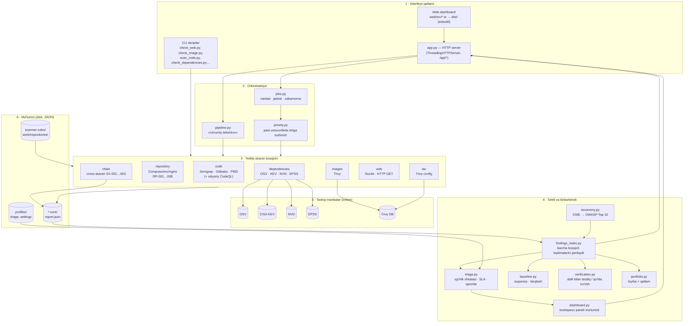

# ThreatChain — umumiy arxitektura

*Bir kompyuter, bir foydalanuvchi uchun, AI ishlatilmaydigan, doim online xavfsizlik platformasi. Kod ichidagi Python paketi tarixiy sabablarga ko'ra `zanjir/` deб nomlanadi.*

Bu hujjat loyihaning **umumiy tuzilishini** — qatlamlar, modullar, ma'lumot oqimi va asosiy qarorlarni tavsiflaydi. Har bir modulning ichki tafsiloti uchun o'sha faylning docstringiga qarang.

---

## 1. Asosiy tamoyillar (nega shunday qurilgan)

Arxitekturaning har bir qismi shu beshta qoidadan kelib chiqadi:

1. **Umumiy ball yo'q.** Og'irlik, bosqich va holat — uchta alohida hisob; hech qachon bitta "risk skori"ga qo'shilmaydi. Har bir skaner boshqa narsani o'lchaydi.
2. **Dalilga asoslangan, manbani ishga tushirmaydi.** Skanerlar faqat statik dalil (kod, config, paket ro'yxati, HTTP javob) o'qiydi; tekshirilayotgan ilovani ishga tushirmaydi.
3. **Maxfiylik.** Manba kodi, token yoki fayl yo'llari tashqi xizmatlarga yuborilmaydi — faqat paket nomi/versiya yoki CVE ID (`nettrust.py` orqali nazorat qilinadi).
4. **Doim online.** CVE/ekspluatatsiya ma'lumotlari (OSV, CISA KEV, NVD, EPSS) real vaqtda olinadi; offline rejim yo'q.
5. **AI ishlatilmaydi.** Barcha qarorlar aniq qoidalar (Semgrep, RP/SX, Trivy) asosida — LLM yoki heuristika emas.

---

## 2. Qatlamli tuzilma



---

## 3. Yettita skaner bosqichi

Har bir bosqich mustaqil: o'z nishoni, o'z asbobi, o'z `*-runs/` papkasi bor. Ular bir-biriga bog'liq emas (faqat `chain` boshqalarning natijasini o'qiydi).

| Bosqich | Modul | Asbob / manba | Nima tekshiradi |
|---|---|---|---|
| **code** | `scanners.py` | Semgrep, Gitleaks, PMD (Apex), ixtiyoriy `deep_analysis.py` (CodeQL) | Koddagi xavfli naqshlar, maxfiy qiymatlar, taint oqimi |
| **repository** | `repository.py` | O'z statik tahlilchisi (RP-001…008) | Compose/env/nginx: ochiq portlar, debug rejim, docker.sock, privileged |
| **dependencies** | `dependencies.py` + `advisories.py` + `threatfeeds.py` | OSV, CISA KEV, NVD, EPSS | Kutubxona CVE'lari, ekspluatatsiya holati, EPSS ehtimoli |
| **images** | `images.py` | Trivy | Docker image qatlamlaridagi paket zaifliklari |
| **iac** | `iac.py` | Trivy config | Terraform/K8s/Docker konfiguratsiya xatolari |
| **web** | `webscan.py` | Nuclei + o'z HTTP tekshiruvlari | Ishlayotgan sayt/API: sarlavhalar, TLS, ma'lum zaifliklar (cheklangan GET) |
| **chain** | `chains.py` | Cross-skaner korrelyatsiya (SX-001…003) | Bir necha bosqich birga tashkil qilgan real xavf (ochiq port + zaif paket) |

Har bir topilma bir xil shaklga keltiriladi: `fingerprint`, `severity`, `cwe_ids`, `owasp_top10_2025`, `verification_note`. Og'irlik ajratish tamoyillari uchun README va `triage.py:SEVERITY_SCALE` ga qarang.

---

## 4. Ma'lumot oqimi

```
Skan boshlanadi (CLI yoki dashboard)
        │
        ▼
Skaner ishlaydi ──► report.json  ──►  <bosqich>-runs/<sana>-<id>/
   (priority.py past ustuvorlikda)          │
                                            ▼
                          findings_index.collect()
                   (har (bosqich, nishon) uchun eng yangi hisobot)
                                            │
              ┌─────────────┬──────────────┼───────────────┐
              ▼             ▼               ▼               ▼
          triage        baseline       verification     portfolio
       (og'irlik/SLA)  (suppress)   (tasdiq/qo'lda)  (loyiha×qatlam)
              │             │               │               │
              └─────────────┴───────┬───────┴───────────────┘
                                    ▼
                          dashboard.overview()  ──►  /api/dashboard  ──►  web panel
```

Muhim: `findings_index` **avtomatik yopilgan** (masalan web tasdiqidan o'tmagan) topilmalarni jamiga qo'shmaydi va ro'yxatda ko'rsatmaydi — ular alohida `dismissed_findings` ro'yxatida qoladi.

---

## 5. Modullar xaritasi

**Interfeys va orkestratsiya**
- `app.py` — HTTP server, barcha `/api/*` marshrutlari, statik fayllarni (xeshlangan, keshlangan) berish
- `pipeline.py` — «Umumiy tekshiruv»: bir necha bosqichni ketma-ket ishga tushirib, dalillarni bog'laydi
- `jobs.py` — skan navbati, avtomatik jadval, o'zgarish xabarnomalari
- `priority.py` — skanerlarni foydalanuvchi ishiga xalaqit bermaydigan past ustuvorlikda ishga tushirish
- `auth.py` — kim foydalana oladi va nima qildi (audit)
- `settings.py`, `notify.py` — lokal sozlamalar, xabar kanallari (webhook/Slack/email)

**Skanerlar (3-bo'limga qarang):** `scanners.py`, `repository.py`, `dependencies.py`, `images.py`, `iac.py`, `webscan.py`, `chains.py`

**Tahlil va birlashtirish**
- `findings_index.py` — barcha bosqich topilmalarini bitta jadvalga jamlaydi, qamrovni hisoblaydi
- `run_index.py` — run papkalari uchun tez xulosa qatorlari (qayta parse qilmasdan)
- `triage.py` — yagona og'irlik shkalasi, SLA muddatlari, qaror holatlari
- `baseline.py` — inson yopgan topilmalarni suppress qilish, skanlar orasidagi farq
- `verification.py` — dalil bilan tasdiqlangan vs qo'lda ko'rilishi kerak
- `taxonomy.py` — CWE → OWASP Top 10:2025 xaritasi
- `portfolio.py` — loyiha × qatlam qamrovi
- `dashboard.py` — boshqaruv paneli uchun barcha ko'rsatkichlar

**Tashqi ma'lumot va yordamchilar**
- `advisories.py`, `threatfeeds.py` — OSV/KEV/NVD/EPSS so'rovlari
- `nettrust.py` — barcha tashqi so'rovlar uchun TLS/proxy siyosati
- `remote_source.py`, `code_targets.py`, `repo_store.py`, `browse.py` — nishon ro'yxatga olish va manba tanlash
- `findings.py` — barqaror `fingerprint` va deduplikatsiya
- `fixes.py` — tuzatish tavsiyalari va diff'lar (maxfiy qatorlar yashiriladi)
- `sbom.py`, `sarif_export.py` — CycloneDX SBOM va SARIF eksport
- `custom_rules.py` — foydalanuvchi yozgan Semgrep qoidalari
- `scan_window.py` — web nishonni qachon va kuniga nechta so'rov bilan skan qilish mumkinligi
- `inventory.py` — fayllarni sanash, `EXCLUDED` papkalar
- `ci_gate.py` — CI uchun o'tish/to'xtash darvozasi
- `engine.py` — barcha modullar ishlatadigan sof primitivlar (`ROOT`, `DATA`, `digest`, `canonical`)

**Frontend** (`web/src/*.ts` → `dist/`, esbuild bilan)
- `app.ts` (asosiy), `shell.ts` (sidebar/modal/sozlamalar), `dashboard.ts`, `findings.ts`, `project.ts`, `scanners.ts`, `dependencies.ts`, `iac.ts`, `web-pilot.ts`, `pilot-dashboard.ts`, `portfolio.ts`, `jobs.ts`
- Qurish: `web/build.mjs` (`dist/` commit qilinadi — ishga tushirish uchun faqat Python kerak)

---

## 6. Ma'lumot modeli (disk)

Hech qanday ma'lumotlar bazasi yo'q — hammasi disk'dagi JSON fayllar:

| Papka | Nima saqlaydi |
|---|---|
| `scanner-runs/`, `repository-runs/`, `dependency-runs/`, `image-runs/`, `iac-runs/`, `web-runs/`, `assessment-runs/` | Har skan uchun `report.json` + dalillar (`<sana>-<id>/`) |
| `profiles/` | Nishon ro'yxatlari, triage qarorlari, lokal sozlamalar |
| `scanner-rules/` | Semgrep/Nuclei qoida paketlari (SHA-256 bilan tekshiriladi) |
| `work/repositories/` | Skan qilinadigan manba nusxalari (masalan `crapi-stable`) — git'ga tushmaydi |
| `vendor/`, `.tools/` | Skaner binari va bog'liqliklari |

`report.json` shakli: `id`, `state` (completed/partial/failed), `findings[]`, `severity_counts`, `verification_summary`, `triage_summary`, `coverage` va bosqichga xos maydonlar.

---

## 7. Xavfsizlik va maxfiylik chegaralari

- **`nettrust.py`** — barcha tashqi ulanishlar faqat ruxsat berilgan manbalarga (OSV/KEV/NVD/EPSS), TLS tekshiruvi bilan.
- **`webscan.py`** — faqat ro'yxatga olingan, ruxsatli nishonlarga; ruxsat oynasi va kunlik so'rov limiti; lokal/intranet manzillar uchun alohida ruxsat.
- **Redaksiya** — `fixes.py` va topilma dalillari maxfiy qiymatlarni (parol, token) `***` bilan yashiradi; faqat xatoning joyi ko'rsatiladi.
- **`auth.py`** — 127.0.0.1 da tinglaydi, kim nima qilganini audit qiladi.
- **CSP** — dashboard `style-src 'self'` ostida; grafik kutubxona yo'q, inline SVG bilan chiziladi.

---

*Batafsil ish holati va cheklovlar uchun: [README.md](README.md), [MUAMMOLAR.md](MUAMMOLAR.md), [REJA.md](REJA.md).*
